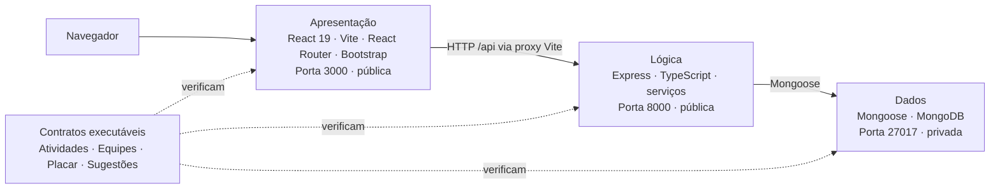

# Arquitetura do OctoFit Tracker

O OctoFit Tracker é uma aplicação de três camadas para um programa de atividades físicas escolar. O código inicial inclui contratos de API e pontos de implementação intencionalmente incompletos para que você use o modo agent do GitHub Copilot em um ciclo guiado por testes.

## Limites entre as camadas

- **Camada de apresentação**: React 19, Vite, React Router, Bootstrap e um cliente compartilhado da API em `octofit-tracker/frontend/src`.
- **Camada de lógica**: rotas e serviços Express com TypeScript em `octofit-tracker/backend/src` expõem o comportamento `/api/*` na porta `8000`.
- **Camada de dados**: modelos Mongoose e dados de demonstração em `octofit-tracker/backend/src/models` e `src/scripts/seed.ts` são persistidos no MongoDB na porta `27017`.

## Portas e regras de ambiente

- MongoDB: `27017` (privada)
- API Express: `8000` (pública)
- Interface Vite: `3000` (pública)
- O navegador acessa caminhos relativos `/api`. O Vite os encaminha para `http://localhost:8000`; `VITE_API_BASE_URL` pode substituir a URL-base.
- Não encaminhe nem torne públicas outras portas.

## Contrato da API

| Capacidade | Método e caminho | Comportamento esperado |
| --- | --- | --- |
| Registro de atividades | `GET /api/activities`, `POST /api/activities` | Lista e cria atividades válidas. POST recebe `userId`, `teamId`, `type` e `minutes`; `userId` e `teamId` devem ser IDs bem-formados de uma pessoa e uma equipe existentes, caso contrário a API retorna um 4xx intencional (nunca um 500 causado por erro de conversão). Uma atividade criada armazena `user`, `team`, `type` e `minutes` enviados, além de `points` e `occurredAt` calculados. |
| Equipes | `GET /api/teams`, `POST /api/teams` | Lista e cria equipes com integrantes. As equipes criadas e listadas mantêm os valores enviados em `name` e `mascot`. Rejeita uma equipe sem nome com `400`. |
| Placar | `GET /api/leaderboard` | Retorna as equipes ordenadas pela soma dos pontos de suas atividades, da maior para a menor. Cada item contém `teamName`, `totalPoints` e uma `rank` iniciada em 1. |
| Sugestões de treino | `GET /api/workouts/suggestions/:userEmail` | Recomenda treinos com base nos padrões de atividade recentes da pessoa correspondente ao e-mail seed. O foco da primeira sugestão (`focus`) corresponde à meta ou à atividade recente dessa pessoa, e o campo `reason` explica o motivo. Um e-mail sem pessoa correspondente retorna um 4xx intencional (por exemplo, `404`). |

## Decisões de implementação

- Decisão da camada de apresentação: componentes React consomem a API pelo cliente compartilhado, sem acessar o banco. Cada capacidade apresenta estados acessíveis de carregamento, vazio e erro, além dos dados retornados pela API.
- Decisão da camada de lógica: rotas Express mantêm o contrato HTTP e delegam validações e regras de negócio aos serviços. Entradas inválidas, referências inexistentes e pessoas não encontradas geram respostas 4xx intencionais.
- Decisão da camada de dados: modelos Mongoose definem campos obrigatórios e referências. O seed usa os modelos da aplicação, é idempotente e preserva registros não relacionados.
- Abordagem para registro de atividades: validar formato e existência de `userId` e `teamId` antes de criar a atividade; persistir os identificadores como `user` e `team`, calcular `points` como `minutes` e definir `occurredAt` no momento da criação.
- Abordagem para gerenciamento de equipes: exigir `name` e `mascot`, preservar os valores enviados e validar integrantes informados antes de salvar suas referências.
- Abordagem para o placar: somar os pontos das atividades por equipe, ordenar do maior total para o menor e atribuir posições começando em 1.
- Abordagem para sugestões de treino: localizar a pessoa pelo e-mail; priorizar o foco de sua atividade mais recente e, na ausência dela, usar `fitnessGoal`. Retornar treinos desse foco com um motivo explicativo; e-mail sem pessoa correspondente retorna 404.

## Plano de testes

Executar nesta ordem durante a implementação, para verificar cada camada antes de avançar:

1. `npm run test:data --prefix octofit-tracker/backend` — valida schemas e seed.
2. `npm run test:api --prefix octofit-tracker/backend` — valida os contratos HTTP e regras dos serviços.
3. `npm test --prefix octofit-tracker/frontend` — valida conteúdo, chamadas à API e estados das telas.
4. `npm run build --prefix octofit-tracker/backend` e `npm run build --prefix octofit-tracker/frontend` — verificam tipos e build de produção.

Baseline executado antes da implementação:

- **Dados** (`npm run test:data --prefix octofit-tracker/backend`): 4 falhas e 1 aprovação. As falhas indicam ausência das validações obrigatórias de usuário, equipe, atividade e treino; o teste de seed/idempotência passou.
- **API** (`npm run test:api --prefix octofit-tracker/backend`): 4 falhas. Atividades e equipes inválidas retornam 501 em vez de 400, o placar não agrega atividades e a sugestão de Mona não corresponde ao foco esperado.
- **Frontend** (`npm test --prefix octofit-tracker/frontend`): 15 falhas. As telas não exibem o conteúdo esperado nem estados de carregamento, vazio e erro, e a chamada de sugestões não corresponde à pessoa esperada.
- **Builds** (`npm run build --prefix octofit-tracker/backend` e `npm run build --prefix octofit-tracker/frontend`): ambos passaram no baseline.
- **Validação auxiliar do exercício** (`node --test tests/exercise-validation.test.mjs`): 4 de 42 testes falharam porque o badge “Copy Exercise” do README não aponta para o template `dev-pods`; é uma falha de metadados, separada dos contratos do OctoFit.
